## Previously ##

Transmitting and recording language

  * phonetics
  * phonology
  * writing 
  * language technology

## Today ##

  * knowledge of grammar
  * words and their composition
      * **morphology**
      * student presentations

# Knowledge of grammar #

## Grammar as science ##

### Scientific method ###

* Science seeks to understand how the world works.
* To attain understanding means to discover basic laws and principles.
* Scientific laws and principles are subject to experimental testing.

## What does any of this have to do with language? ##

* What does it mean to *understand* grammar?
* What *laws and principles* of grammar might there be?
* How can those laws and principles of grammar be *tested experimentally*?


## Why study grammar? ##

Grammar is a bridge between sound and meaning

* semantics --- **grammar (morphology + syntax)** --- phonetics and phonology

Natural-language objects are hierarchical structures

  * syllables (onset, nucleus, coda)
  * words
  * phrases 
  * sentences

## What does grammar study? ##

Informally defined, grammar studies **combinatorial rules**.

- *Key fact*: native speakers/signers perceive certain strings as  **acceptable** and other strings as **unacceptable**.

## Examples ##

- *denationalisation*: acceptable
- *nationalisationde*: unacceptable

**NB:** we'll be using the symbol ‘\*’ in front of an expression to mean ‘meh’ from now on

- \**nationalisationde*
- as well as the other 118 remaining combinations of *de-*, *nation*, *-al*, *-ise-* and *-ation*

# Is grammar necessary? #

##  ##

**Q**: Why bother studying the rules of grammar? Any native speaker knows them anyway!

**A**: Speakers know them tacitly and implicitly but cannot formulate them explicitly. A more accurate description would be that speaker *possesses* the rules of grammar, just as they possess the visual system [@Ludlow:2011], in contrast to the rules of chess, artificial languages etc.

##  ##

**Q**: But do we need some special language rules? Perhaps people just memorise the strings they encounter.

**A**: The number of acceptable expressions is potentially infinite, far greater than can be memorised. Besides, people can judge expressions (words, phrases and sentences) as acceptable or unacceptable that they have never encountered before.

##  ##

**Q**: Speakers judge *denationalisation* as acceptable because they understand its meaning.

**A**: Speakers can judge **semantically odd** strings as acceptable and *vice versa*.

(@) 'Twas brillig and the slithey toves did gyre and gimble in the wabe.
(@) \*Me not understanding you.
(@) Colourless green ideas sleep furiously.
(@) \*The child seems sleeping.

##  ##

**Q**: What if a speaker errs in their judgement? After all, there are such things as **grammaticality illusions**.
    * *More people have been to Russia than I have.*

**A**: Other cognitive systems, e.g. the visual system, may err but this doesn't mean people should stop studying them.

. . . 

::: {style="text-align: center;"}
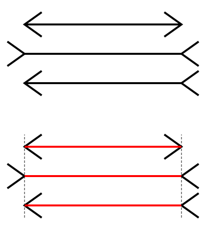{ width=30% }
:::

##  ##

We'll start our exploration of the grammatical rules and regularities by considering what words are.

# Morphology #

## Definitions ##

**Morphology** is the study of words and their internal constitution.

But what's a **word**? No precise definition! 

## What is a word?

But we can identify a cluster of properties:

  * discreteness
      * e.g., words are separated by spaces or other conventions in other writing systems
  * one main stress per word
  * single idea/concept
  * autonomy

Lots of fuzzy, grey area here, though.

## The grey area: discreteness ##

*Bertram's father-in-law's just made him a cuppa tea*

  * is *father-in-law's* one word, or are there more?
  * is *cuppa* one word or are these actually two words (*cup* and *of*)?
  * what about *Bertram's*?

## Morphemes ##

More definitions:

  * Words can be split up into smaller units.
  * A **morpheme** is the smallest meaningful linguistic unit.

Can you think of counterexamples?

## Meaningful units? ##

We can represent them as sound-meaning pairings:

::: {style="text-align: center;"}
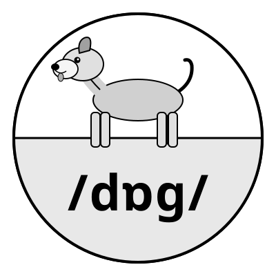{ width=20% }
:::

. . . 

How about *-ify*, or *-er*?

## Words, lexemes, morphemes and features {.scrollable}

#### Morpheme ####

* smallest meaning-carrying unit

#### Lexeme ####

* smallest free-standing meaning-carrying unit
    * also *free morpheme*

#### Affix ####

* morpheme that is not free
    * also *bound morpheme*

#### Word ####

* meaning-carrying unit

## Roots and affixes ##

  * in English, roots are free morphemes
      * take *denationalisation* we have already examined: *nation* is its root, and it is a free morpheme that can be used in isolation
  * not necessarily so in other languages

## Examples ##

* door
* independently

## Morpheme, lexeme or word? ##

* *door* = morpheme, lexeme **and** word
	- not mutually exclusive
* *independently* = complex **word**
	- *depend-* = **lexeme** (and a morpheme, obvs)
	- *in-*,  *-ent*, *-ly* = **morphemes**

## What does a native speaker of a language need to know? {.scrollable}

Sticking with *denationalisation*, the speaker needs to know

1. each of the five morphemes: *de-*, *nation*, *-al*, *-ise*, *-ation*
2. what kind of morpheme each of them is
    1. Is it free? 
    2. If it is bound, is it a prefix, a suffix, or something else entirely?
4. what the morpheme attaches to
   1. *national* + *-ise*
   2. \**speak* + *-ise*
5. that this attachment relation is a **local** one
6. what is the result of attaching a morpheme to another

To do that, more observation and generalisation is required.

## Positional types of affixes: prefixes, suffixes  ##

(and infixes, and circumfixes)

| **Prefixes**   | **Suffixes**   |
| :-:            | :-:            |
| **a**symmetric | treat**able**  |
| **in**adequate | synthes**ise** |
| **pro**active  | leader**ship** |

Frequently, more than one affix (prefix/suffix) can be added, just as in *denationalisation*

**Tip:** Think about it as a step-by-step process (1 affix per step).

## Word classes ##

Word classes (aka ‘parts of speech’) are an attempt at finding regularities in natural-language expressions.

* traditional definitions familiar from school are unreliable and circular
* instead, formal and distributional criteria are called for
    * such criteria are **deductive** in character

## Word classes: school definitions

Let's briefly consider two:

* Nouns denote objects.
* Verbs denote actions.

What's wrong with these?

## Formal criteria ##

involve unifying words into classes based on their **form**, i.e. how they **look**.

* **verbs:** *-ed* and its allomorphs
* **nouns:** singular vs. plural forms (*glass -- glasses*; *goose -- geese*)
* **adjectives:** forms of comparison (*tall -- taller -- tallest*)

## Lexical and functional categories ##

in different parlance, **open-class expressions** vs. **closed-class expressions** (or **notion words** and **function words**)

## Open-class expressions ##

**Lexical categories** possess a relatively obvious descriptive content

  * nouns (category N) -- *desk, jacket, solitude, prowess*
  * adjectives (category A) -- *noticeable, yellow, spicy*
  * verbs (category V) -- *attend, run, rejoice*

## Closed-class expressions ##

**Functional categories** only carry grammatical meaning

  * determiners/articles (category D) -- *the, each*
  * prepositions (category P) -- *above, in front of, under, behind*
  * complementisers (category C) -- *that, if, whether*

## Many affixes are category-specific ##

In one of two ways:

  * they either place restrictions on the category (part of speech) of the thing with which they combine
  * or turn one category into another
  
## Inflectional and derivational morphology ##

  * **Derivational** affixes make new words out of their host.
      * very clear semantic/conceptual content
  * **Inflectional** morphology creates a version of the same word.
      * part of speech remains the same
          * also true of some derivational morphology

## Affixes as operations ##

### Reduplication ###

  * Indonesian *gado* ‘vegetable’ → *gado-gado* ‘vegetables’

### Umlaut, ablaut, tone and stress change ###

  * Umlaut: *tooth--teeth*, German *Gott--Götter* ‘god--gods’, Dutch *pad--paden* ‘path--paths’
  * Ablaut: *get--got*, *see--saw*
  * Stress change: *REcord* (noun) vs. *reCORD* ‘verb’  

## Compounds ##

Words formed by combining other words:

| **compound**                                        | **category** | **idiomatic?** |
| :-:                                                 | :-:          | :-:            |
| babysit                                             | V            | yes            |
| bartend                                             | V            | no             |
| part supplier                                       | N            | no             |
| anti-missile missile                                | N            | no             |
| kitchen towel rack                                  | N            | no             |
| writer club address list                            | N            | no             |

What's the pattern?

## Right-Hand Head Rule (RHHR) ##

Simplifying for now, all English compounds look roughly like this:

::::: columns
::: {.column width="30%"}
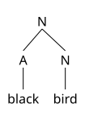
:::
::: {.column width="30%"}
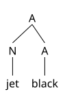
:::
::: {.column width="30%"}
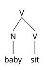
:::

::::

See the pattern yet?

. . . 

**The rightmost element of a compound is the head of the compound.**

## Affixes are category- and subcategory-specific ##

Categories can have subcategories.

::: {.panel-tabset}
### Plural ###

* book + -s → books
* match + -es → matches
* quickly + -s → \*quicklies

### Past ###

* walk + -ed → walked
* watch + -ed → watched
* read + ?? → read
* little + -ed → \*littled

:::

## Back to _denationalisation_ ##

de, nation, al, ise, ation

. . . 

What order do we combine them in, and what goes with what?

. . . 

Any further restrictions? 

neighbourhood + -al $\rightarrow$ \*neighbourhoodal

honesty + -al $\rightarrow$ \*honestial

## Affixes are (sub)category-specific 

Let us consider a few examples of (sub)category-specificity

::: panel-tabset
### Affix selects N to make N ###

  * -(i)an: library + -an $\rightarrow$ librarian
  * -age: orphan + -age $\rightarrow$ orphanage
  * -ism: manner + -ism $\rightarrow$ mannerism

### Affix selects N to make V ###

  * -ate: origin + -ate $\rightarrow$ originate
  * -ise: symbol + -ise $\rightarrow$ symbolise

### Affix selects V to make A ###

  * -ant: defy + -ant $\rightarrow$ defiant
  * -ive: restrict + -ive $\rightarrow$ restrictive

:::

## Back to _denationalisation_ ##

The *nation*, *-al*, *-ise* and *-ation* bits are pretty clear, giving us

::: {style="text-align: center;"}
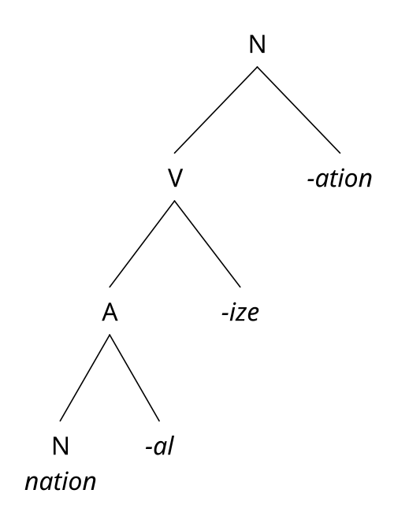{ width=35% }
:::

Where does the *de-* fit in?

##  ##

*Denationalisation* is when you *denationalise* something

  * consequently, *de-* must attach to the verb in this instance
  
::: {style="text-align: center;"}
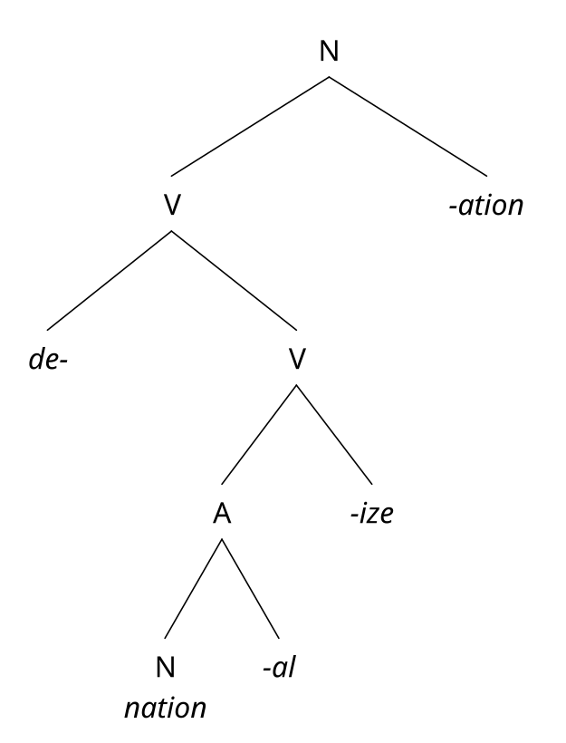{ width=40% }
:::

## Structure determines meaning ##

What does *unlockable* mean?

::: {.incremental}
  * something that could not be locked;
  * something that could be unlocked.
:::

How does the same string give multiple meanings?

-------------

::::: columns
::: {.column width="45%"}
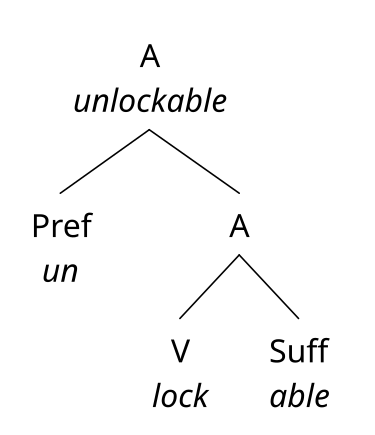
:::

::: {.column width="45%"}
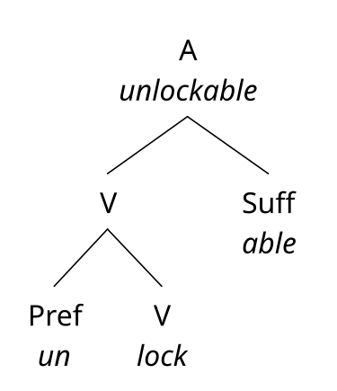
:::
:::::

Similar to what we established for sentences in Week 1!

## Summary ##

* to describe the structure of an object, we look for regularities
  * applied to the structure of natural-language objects, this entails looking for grammatical regularities
      * to establish the relationships between the parts of a whole, these parts must be **found** and **categorised**
  * every natural-language speaker is capable of distinguishing between sequences of symbols/sounds that are a sentence in that language, and those that are not.
  
# In-class activities

## Task 1: Segmentation into morphemes ##

Sometimes multiple answers are correct:

  * *saltpetre* (monomorphemic) vs. *salt*+*petre*
  * *democrat* (monomorphemic) vs. *demo*+*crat*

## Task 3. Cebuano morphology ##

::: {.panel-tabset}

### Prefixation and infixation

* if the stem begins with a vowel, prefix *in-*;
  * *inglis* → ***in-*** + *inglis*
* if the stem begins with a consonant, infix *-in-* after that consonant
  * *sibwano* → *s-*  + ***-in-** -ibwano*
  
### Infixation only

Assume all syllables have a C-onset:

* ***si**bwano*: CV
* **∅*****i**nglis*: CV(C)

Infix *-in-* between onset and nucleus:

* *s-ibwano*: *s-* + *-in-* *-ibwano*
* ∅-*inglis*: ∅- + *-in-* *-inglis*
:::

[from @Fromkin:2013]

## Homework: ‘postmodernism’

Two initially plausible candidate structures:

::: {style="text-align: center;"}
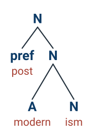{ width=25% } 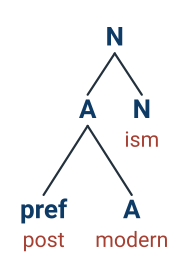{ width=25% }
:::

How do we decide which one is the more plausible one?

::: notes
*post-* can attach to N or A: *postlude*, *postscriptum* or *postnatal*, *postoperative* etc.

**compositionality:** not ‘coming after modernism’ but ‘something associated with being *postmodern*’.
:::

# Morphological typology #

## Language around the globe ##

  * around 7,000 languages
  * languages > language groups > language families
      * **genealogical principle**\
	  $\rightarrow$ explains some similarities between languages but not others
  * organisation of grammatical building blocks
      * **typological principle**\
	  $\rightarrow$ also explains some similarities between languages but not others

##  ##

::: {style="text-align: center;"}

:::

## Genealogical principle at work {.smaller}

It can explain certain things by common origin.

::: {.panel-tabset}

### Germanic past ###

  * Usage of *-t-/-d-* for past tense
      * German: *machen* ‘make’ — (ich) machte ‘I made’
      * Dutch: *maken* ‘make’ — (ik) maakte ‘I made’
      * …

### Germanic conjugation ###

  * German *heißen*: *ich heiße — du heißt — er heiß — wir heißen* etc.
  * Dutch *heten*: *ik heet — jij heet — hij heet — wij heten* etc.
  * Norwegian *hete*: *jeg/du/… heter*

:::

## Genealogical principle at work {.smaller}

:::: {.panel-tabset}

### Romance future 

Usage of infinitive + present-tense form of *have*

<!--
| Person | French (*chanter*) | Spanish (*cantar*) | Portuguese (*cantar*) |
|:-------|:-------------------|:-------------------|:----------------------|
| **1sg** | je chanter**ai** | cantar**é** | cantar**ei** |
| **2sg** | tu chanter**as** | cantar**ás** | cantar**ás** |
| **3sg** | il/elle chanter**a** | cantar**á** | cantar**á** |
-->

```{=html}
<table class="periphrastic">
  <thead>
    <tr>
      <th>Language</th>
      <th>Infinitive</th>
      <th>+ "have"</th>
      <th>Future form</th>
    </tr>
  </thead>
  <tbody>
    <tr>
      <td>French</td>
      <td class="inf">chanter</td>
      <td class="aux">
        <div>+ <strong>ai</strong> <span class="gloss">(1sg)</span></div>
        <div>+ <strong>as</strong> <span class="gloss">(2sg)</span></div>
        <div>+ <strong>a</strong> <span class="gloss">(3sg)</span></div>
      </td>
      <td class="fut">
        <div>chanter<strong>ai</strong></div>
        <div>chanter<strong>as</strong></div>
        <div>chanter<strong>a</strong></div>
      </td>
    </tr>
    <tr>
      <td>Spanish</td>
      <td class="inf">cantar</td>
      <td class="aux">
        <div>+ <strong>he</strong> <span class="gloss">(1sg)</span></div>
        <div>+ <strong>has</strong> <span class="gloss">(2sg)</span></div>
        <div>+ <strong>ha</strong> <span class="gloss">(3sg)</span></div>
      </td>
      <td class="fut">
        <div>cantar<strong>é</strong></div>
        <div>cantar<strong>ás</strong></div>
        <div>cantar<strong>á</strong></div>
      </td>
    </tr>
    <tr>
      <td>Portuguese</td>
      <td class="inf">cantar</td>
      <td class="aux">
        <div>+ <strong>hei</strong> <span class="gloss">(1sg)</span></div>
        <div>+ <strong>hás</strong> <span class="gloss">(2sg)</span></div>
        <div>+ <strong>há</strong> <span class="gloss">(3sg)</span></div>
      </td>
      <td class="fut">
        <div>cantar<strong>ei</strong></div>
        <div>cantar<strong>ás</strong></div>
        <div>cantar<strong>á</strong></div>
      </td>
    </tr>
  </tbody>
</table>
```

This has a historical explanation.

<!--| Person | French (*chanter*) | Spanish (*cantar*) | Portuguese (*cantar*) | French *avoir* | Spanish *haber* | Portuguese *haver* |
|:-------|:-------------------|:-------------------|:----------------------|:---------------|:----------------|:-------------------|
| **1sg** | je chanter**ai** | cantar**é** | cantar**ei** | j'**ai** | h**e** | h**ei** |
| **2sg** | tu chanter**as** | cantar**ás** | cantar**ás** | tu **as** | h**as** | h**ás** |
| **3sg** | il/elle chanter**a** | cantar**á** | cantar**á** | il/elle **a** | h**a** | h**á** |
-->

### Romance conjugation

::: {.panel-tabset}

#### French 

:::: {.columns}

::: {.column width="50%"}

| Personne | Forme | API |
|:---------|:------|:----|
| je       | chante | /ʃɑ̃t/ |
| tu       | chantes | /ʃɑ̃t/ |
| il/elle/on | chante | /ʃɑ̃t/ |
:::

::: {.column width="50%"}

| Personne | Forme | API |
|:---------|:------|:----|
| nous     | chantons | /ʃɑ̃.tɔ̃/ |
| vous     | chantez | /ʃɑ̃.te/ |
| ils/elles | chantent | /ʃɑ̃t/ |
:::

::::


#### Italian

:::: {.columns}

::: {.column width="50%"}
| Persona | Forma |
|:--------|:------|
| io      | canto |
| tu      | canti |
| lui/lei/Lei | canta |
:::

::: {.column width="50%"}
| Persona | Forma |
|:--------|:------|
| noi     | cantiamo |
| voi     | cantate |
| loro    | cantano |
:::

::::

#### Portuguese

:::: {.columns}

::: {.column width="50%"}
| Pessoa | Forma |
|:--------|:------|
| eu      | canto |
| tu      | cantas |
| ele/ela/você | canta |
:::

::: {.column width="50%"}
| Pessoa | Forma |
|:--------|:------|
| nós     | cantamos |
| [vós]{.ep} | [cantais]{.ep} |
| eles/elas/vocês | cantam |
:::

::::

::: notes

* The differences lie in pronoun usage:
  * EP: *tu cantas* (standard informal 2sg); *vós* archaic.
  * BP: *você canta* (dominant 2sg); *a gente canta* (colloquial 1pl); *vocês cantam* (2pl).
:::

:::

::::

## Limits of morphological variation ##

Two main parameters

  * degree of allomorphy and fusion
      * how clearly morphological information can be segmented
  * degree of synthesis
      * how many morphemes a run-of-the-mill word has

## Ideal case? ##

very clear boundaries between individual morphemes

## Allomorphy

variable realisation of a morpheme.

* *cup* vs. *cup**s*** (/kʌp/ vs. /kʌps/)
* *neck* vs. *neck**s***
* *set* vs. *set**s***
    * but *mug* vs. *mug**s*** (/mʌɡ/ vs. /mʌɡz/)
    * *bed* vs. *bed**s*** (/bɛd/ vs. /bɛdz/)
    * *sketch* vs. *sketch**es*** (/skɛʧ/ vs. /ˈskɛʧɪz/)
    
## Fusion ##
	
simultaneous realisation of multiple morphemes with unclear boundaries.

  * *чесать* vs. *чешу* *vs.* *чешет*
      * where's the root? what's the morpheme for 1 or 2 person? what's the morpheme for number? what's the morpheme for present tense?

. . . 

Degree of fusion can vary from *low* (so-called **agglutinative** or **agglutinating** languages: Turkish, Japanese etc.) to *high* (so-called **fusional** languages: Russian, French etc.)

## Low degree of fusion: Turkish ##

Every morpheme is clearly separable from every other morpheme

  
  * Turkish noun: *oda* ‘room’ — *oda-da* ‘in the room’; *oda-lar* ‘rooms’ — *oda-lar-da* ‘in the rooms’
  * Turkish verb: *sev-* ‘like’ — *sev-di-m* ‘like-[pst-1sg]{.smallcaps}’; *sev-* + *-me-* + *-di-* + *-m* ‘like-[neg-pst-1sg]{.smallcaps}’
  


## Declension of *ev* ‘house’ in Azeri

| Case | Root | ([pl]{.smallcaps}) | Case Marker |
|:-----|:-----|:-------------------|:------------|
| [nom]{.smallcaps} | ev | (-lər) | — |
| [gen]{.smallcaps} | ev | (-lər) | -in |
| [dat]{.smallcaps} | ev | (-lər) | -ə |
| [acc]{.smallcaps} | ev | (-lər) | -i |
| [loc]{.smallcaps} | ev | (-lər) | -də |
| [abl]{.smallcaps} | ev | (-lər) | -dən |

If we know that, for instance, *-(i)miz-* is the [1pl]{.smallcaps} suffix, we should have no difficulty figuring out the meaning of *evlərimizdən*, or forming any nominal case form.

## High degree of fusion

* multiple meanings per morpheme at a time
* difficult segmentation due to blurred morpheme boundaries
* lots of irregularity

## Multiple meanings per morpheme 

::: {.panel-tabset}

### Russian present tense
 
<style>
  table.conj { border-collapse: collapse; font-family: sans-serif; font-size: 0.7em; }
  table.conj th, table.conj td { border: 1px solid #999; padding: 6px 18px; text-align: center; }
  table.conj th { background: #f0f0f0; }
  .stem { color: #222; }
  .end  { color: #1a56db; font-weight: bold; }   /* fusional endings */
  .mut  { color: #c81e1e; font-weight: bold; }   /* consonant mutation д→ж */
  .stress { text-decoration: underline; }        /* stressed vowel */
</style>

<table class="conj">
  <thead>
    <tr>
      <th>Singular</th>
      <th>Plural</th>
    </tr>
  </thead>
  <tbody>
    <tr>
      <td>1sg&nbsp;&nbsp;<span class="stem">хо</span><span class="mut">ж</span><span class="end">у́</span></td>
      <td>1pl&nbsp;&nbsp;<span class="stem">ход</span><span class="end">им</span></td>
    </tr>
    <tr>
      <td>2sg&nbsp;&nbsp;<span class="stem">ход</span><span class="end">ишь</span></td>
      <td>2pl&nbsp;&nbsp;<span class="stem">ход</span><span class="end">ите</span></td>
    </tr>
    <tr>
      <td>3sg&nbsp;&nbsp;<span class="stem">ход</span><span class="end">ит</span></td>
      <td>3pl&nbsp;&nbsp;<span class="stem">ход</span><span class="end">ят</span></td>
    </tr>
  </tbody>
</table>

### Portuguese present tense

<style>
  table.pt { border-collapse: collapse; font-family: sans-serif; font-size: 0.7em; }
  table.pt th, table.pt td { border: 1px solid #999; padding: 6px 12px; text-align: center; }
  table.pt th { background: #f0f0f0; }
  table.pt caption { caption-side: top; font-weight: bold; padding-bottom: 8px; }
  .stem    { color: #222; }
  .end     { color: #1a56db; font-weight: bold; }   /* fusional person/number endings */
  .them    { color: #0a7d3b; font-weight: bold; }   /* thematic vowel */
  .mut     { color: #c81e1e; font-weight: bold; }   /* stem/orthographic change (1sg) */
</style>

<table class="pt">
  <thead>
    <tr>
      <th rowspan="2">Person</th>
      <th colspan="2">falar “to speak” (-ar)</th>
      <th colspan="2">comer “to eat” (-er)</th>
    </tr>
    <tr>
      <th>Indicativo</th>
      <th>Subjuntivo</th>
      <th>Indicativo</th>
      <th>Subjuntivo</th>
    </tr>
  </thead>
  <tbody>
    <tr>
      <td>eu</td>
      <td><span class="stem">fal</span><span class="end">o</span></td>
      <td><span class="stem">fal</span><span class="them">e</span></td>
      <td><span class="stem">com</span><span class="end">o</span></td>
      <td><span class="stem">com</span><span class="them">a</span></td>
    </tr>
    <tr>
      <td>tu</td>
      <td><span class="stem">fal</span><span class="them">a</span><span class="end">s</span></td>
      <td><span class="stem">fal</span><span class="them">e</span><span class="end">s</span></td>
      <td><span class="stem">com</span><span class="them">e</span><span class="end">s</span></td>
      <td><span class="stem">com</span><span class="them">a</span><span class="end">s</span></td>
    </tr>
    <tr>
      <td>ele / ela / você</td>
      <td><span class="stem">fal</span><span class="them">a</span></td>
      <td><span class="stem">fal</span><span class="them">e</span></td>
      <td><span class="stem">com</span><span class="them">e</span></td>
      <td><span class="stem">com</span><span class="them">a</span></td>
    </tr>
    <tr>
      <td>nós</td>
      <td><span class="stem">fal</span><span class="them">a</span><span class="end">mos</span></td>
      <td><span class="stem">fal</span><span class="them">e</span><span class="end">mos</span></td>
      <td><span class="stem">com</span><span class="them">e</span><span class="end">mos</span></td>
      <td><span class="stem">com</span><span class="them">a</span><span class="end">mos</span></td>
    </tr>
    <tr>
      <td>vós</td>
      <td><span class="stem">fal</span><span class="them">a</span><span class="end">is</span></td>
      <td><span class="stem">fal</span><span class="them">e</span><span class="end">is</span></td>
      <td><span class="stem">com</span><span class="them">e</span><span class="end">is</span></td>
      <td><span class="stem">com</span><span class="them">a</span><span class="end">is</span></td>
    </tr>
    <tr>
      <td>eles / elas / vocês</td>
      <td><span class="stem">fal</span><span class="them">a</span><span class="end">m</span></td>
      <td><span class="stem">fal</span><span class="them">e</span><span class="end">m</span></td>
      <td><span class="stem">com</span><span class="them">e</span><span class="end">m</span></td>
      <td><span class="stem">com</span><span class="them">a</span><span class="end">m</span></td>
    </tr>
  </tbody>
</table>

:::

## Segmentation difficulties

<style>
  table.fr { border-collapse: collapse; font-family: sans-serif; font-size: 0.7em; }
  table.fr th, table.fr td { border: 1px solid #999; padding: 7px 18px; text-align: center; }
  table.fr th { background: #f0f0f0; }
  table.fr caption { caption-side: top; font-weight: bold; padding-bottom: 8px; }
  .prep { color: #1a56db; font-weight: bold; }   /* preposition à */
  .art  { color: #0a7d3b; font-weight: bold; }   /* definite article */
  .fuse { color: #c81e1e; font-weight: bold; }   /* fused form */
</style>

<table class="fr">
  <thead>
    <tr>
      <th>Article</th>
      <th>à + article</th>
      <th>Result</th>
      <th>Fusion?</th>
    </tr>
  </thead>
  <tbody>
    <tr>
      <td>le (masc. sg.)</td>
      <td><span class="prep">à</span> + le</td>
      <td><span class="fuse">au</span></td>
      <td>yes (obligatory)</td>
    </tr>
    <tr>
      <td>la (fem. sg.)</td>
      <td><span class="prep">à</span> + la</td>
      <td><span class="prep">à</span> la</td>
      <td>no</td>
    </tr>
    <tr>
      <td>l’ (sg. before vowel)</td>
      <td><span class="prep">à</span> + l’</td>
      <td><span class="prep">à</span> l’</td>
      <td>no</td>
    </tr>
    <tr>
      <td>les (pl.)</td>
      <td><span class="prep">à</span> + <span class="art">les</span></td>
      <td><span class="fuse">aux</span></td>
      <td>yes (obligatory)</td>
    </tr>
  </tbody>
  <caption>French: fusion of <em>à</em> + definite article</caption>
</table>

## Degree of synthesis 

How many morphemes per word, on average?

::: {.incremental}

* one
* many
* anything in between

:::


## (Very) few morphemes per word: Isolating ##

](chinese-isolating.jpg){ width=50% }

## Lots of morphemes: Polysynthetic ##

](https://64.media.tumblr.com/f6ce0dc21e59399f78a40c4cf40929b6/tumblr_mn4boyZ1SP1rwewyjo4_540.gif){ width=40% }


## References
